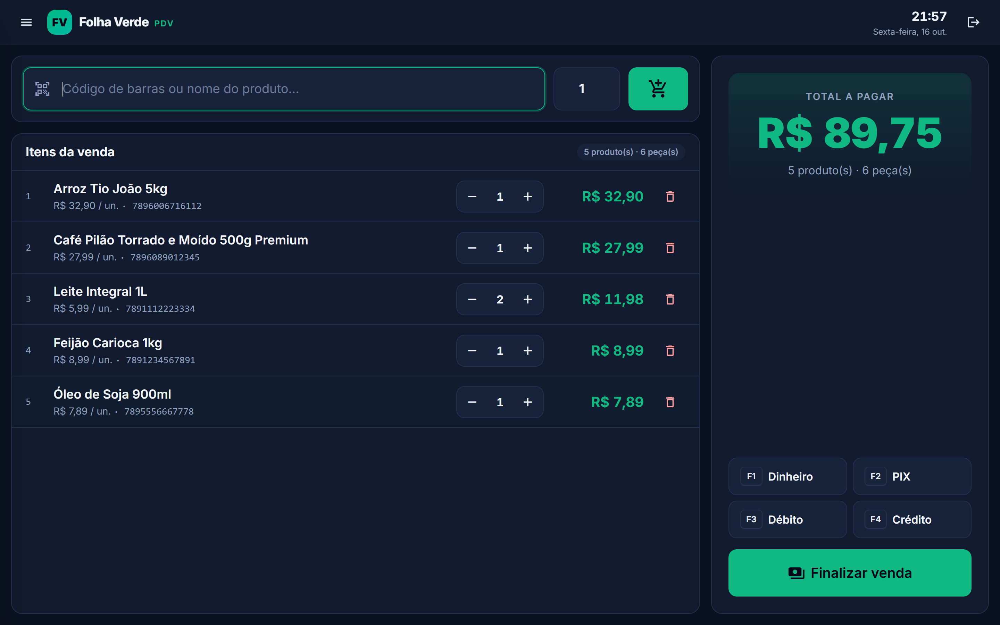
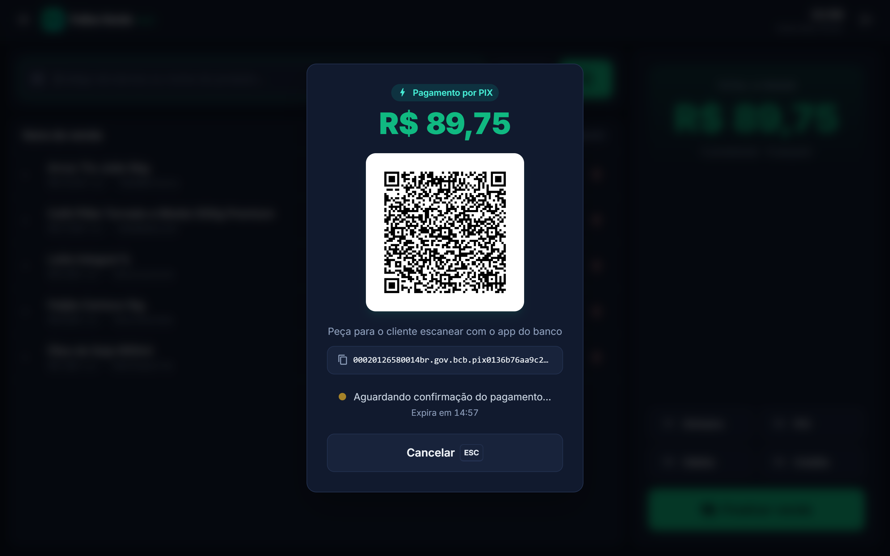
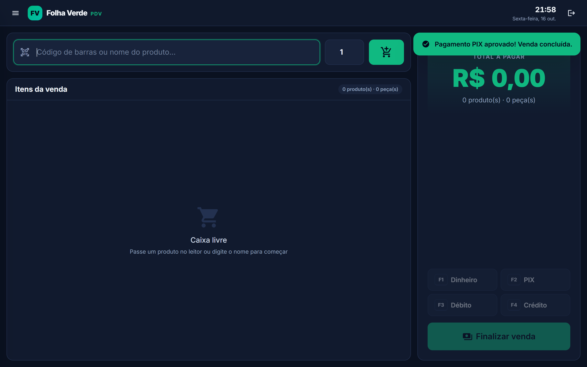
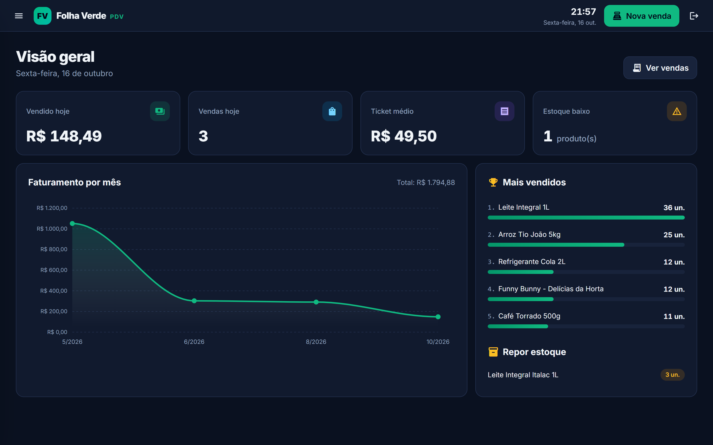
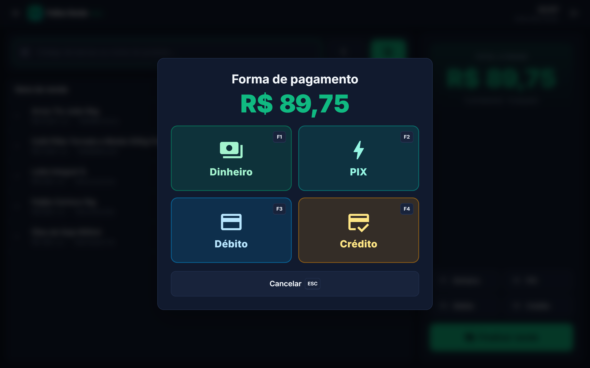
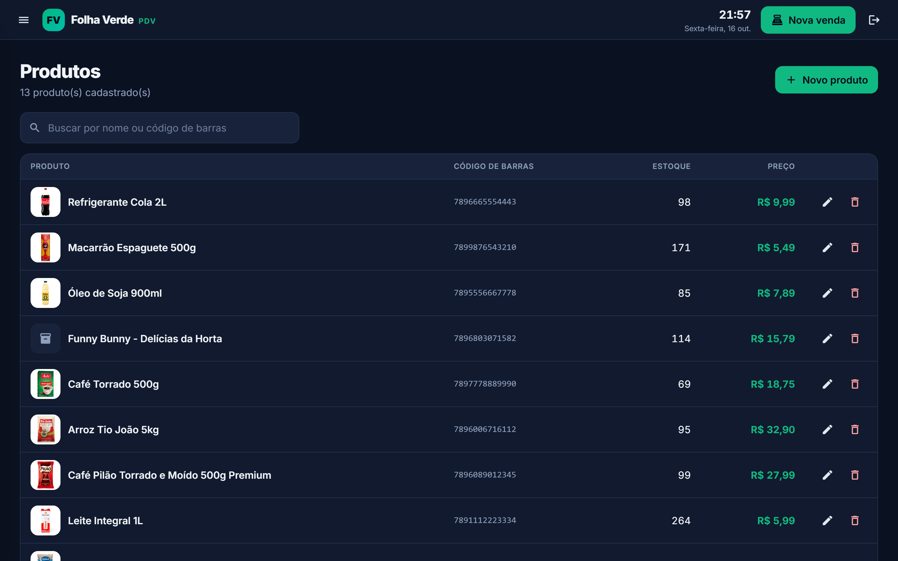
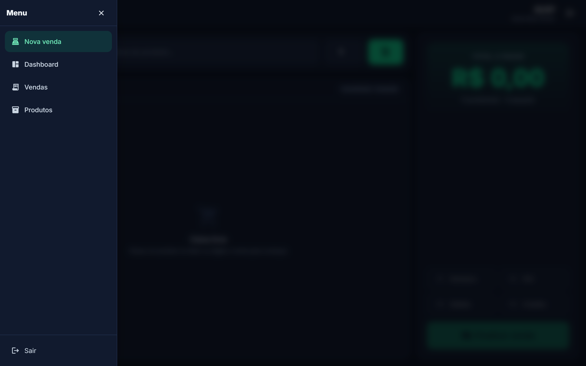
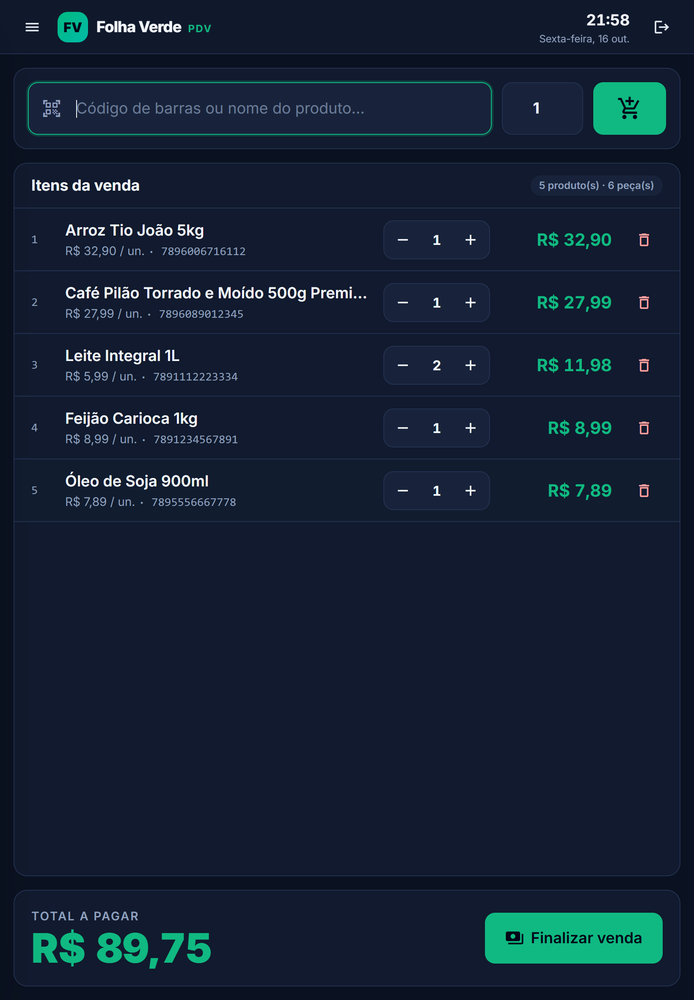
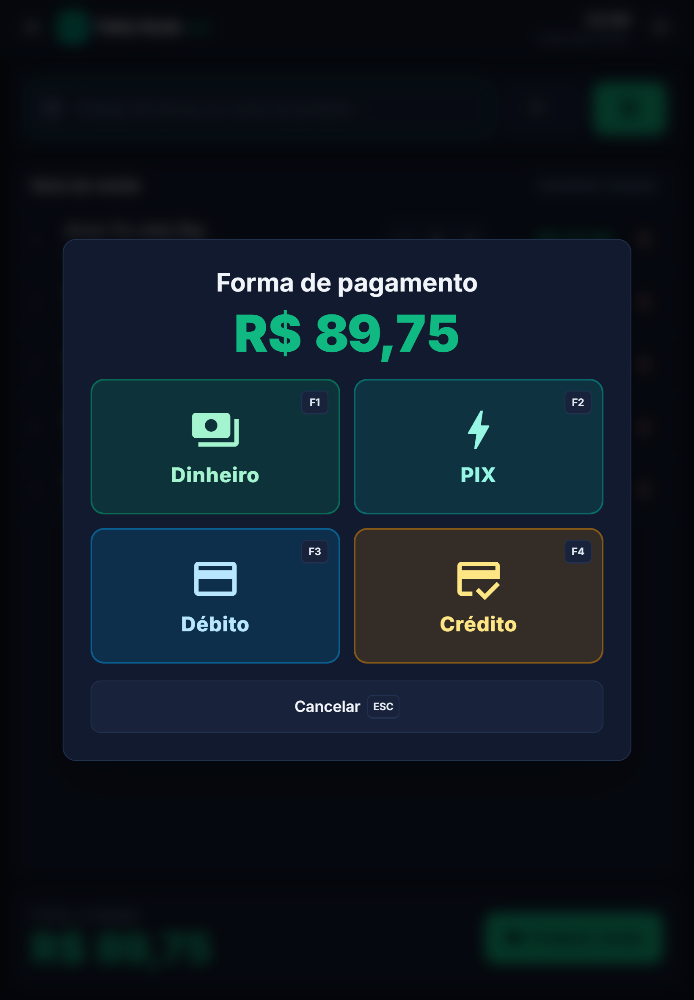
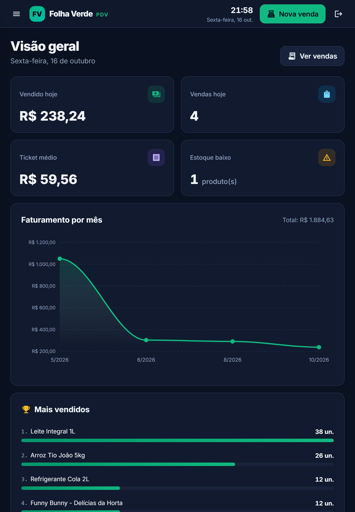

# Mercado — Sistema de PDV (Ponto de Venda)

[](https://github.com/FelipeProdossimo/mercado-pdv/actions/workflows/ci.yml)


Sistema full-stack de ponto de venda para mercado/loja física: controle de produtos e estoque, abertura/fechamento de caixa, vendas com pagamento em dinheiro, cartão ou PIX (integração real com Mercado Pago), dashboard, relatórios e emissão de NFC-e.

- **API**: [`Mercado.Api`](Mercado.Api) — .NET 9, PostgreSQL, JWT
- **Front-end**: [`mercado-web`](mercado-web) — Angular 20, Angular Material, Tailwind CSS

## Telas

**Caixa (PDV):** leitor de código de barras, total sempre visível e atalhos F1–F4 para a forma de pagamento.



| PIX com QR Code real (sandbox do Mercado Pago) | Confirmação automática do pagamento |
|---|---|
|  |  |

| Dashboard | Forma de pagamento |
|---|---|
|  |  |

| Produtos | Menu recolhível |
|---|---|
|  |  |

**No tablet:** em pé, o total vira uma barra fixa embaixo, e os botões têm tamanho de toque.

| Caixa | Pagamento | Dashboard |
|---|---|---|
|  |  |  |

## Funcionalidades

- **Autenticação** com JWT + refresh token e controle de papéis (roles) de usuário
- **Produtos**: cadastro, edição, upload de imagem, soft delete, controle de estoque
- **Caixa**: abertura e fechamento, com conferência de valores por forma de pagamento
- **Vendas**: carrinho, múltiplas formas de pagamento
  - **Dinheiro/Débito/Crédito simples**: registrado direto, sem gateway
  - **PIX real**: gera QR Code via [Mercado Pago](https://www.mercadopago.com.br/developers) (API de Orders), com polling de status, expiração em 15 min e cancelamento — estoque só é baixado quando o pagamento é confirmado
  - **Cartão via Mercado Pago**: tokenização segura no front (o número do cartão nunca passa pelo back-end)
- **Notificações em tempo real** via SignalR (ex.: atualização de status de pagamento)
- **Dashboard** com faturamento do dia, ticket médio, gráfico mensal (ApexCharts) e produtos mais vendidos, considerando só vendas aprovadas
- **Relatórios** em PDF (QuestPDF) no back-end; a tela de relatórios do front ainda está em desenvolvimento
- **Emissão de NFC-e** via [Focus NFe](https://focusnfe.com.br) (modelo implementado, aguardando CNPJ/homologação para teste ponta a ponta)

## Stack

| Camada | Tecnologias |
|---|---|
| Back-end | .NET 9, ASP.NET Core Web API, Entity Framework Core, PostgreSQL (Npgsql), SignalR, JWT Bearer, BCrypt, QuestPDF, Swagger/OpenAPI |
| Front-end | Angular 20, Angular Material, Angular CDK, Tailwind CSS, ApexCharts, SignalR client, RxJS |
| Integrações | Mercado Pago (PIX e cartão via API de Orders), Focus NFe (NFC-e) |

## Como rodar localmente

### Pré-requisitos

- [.NET 9 SDK](https://dotnet.microsoft.com/download)
- [Node.js](https://nodejs.org/) 20+ e [Angular CLI](https://angular.dev/tools/cli) (`npm install -g @angular/cli`)
- PostgreSQL rodando localmente

### 1. API (`Mercado.Api`)

```bash
cd Mercado.Api
dotnet user-secrets set "ConnectionStrings:DefaultConnection" "Host=localhost;Port=5432;Database=mercado_db;Username=SEU_USUARIO;Password=SUA_SENHA"
dotnet user-secrets set "Jwt:Key" "uma-chave-secreta-longa-qualquer"
dotnet run
```

`appsettings.json` no repositório traz apenas placeholders — configure os valores reais via **User Secrets** (comandos acima) ou variáveis de ambiente, nunca direto no arquivo versionado.

Para configurar a integração real de PIX/cartão via Mercado Pago (opcional, só necessário para testar pagamentos), veja o passo a passo detalhado em [`Mercado.Api/README.md`](Mercado.Api/README.md).

A API sobe com Swagger habilitado em `/swagger` e aplica as migrations do banco automaticamente ao iniciar.

### 2. Front-end (`mercado-web`)

```bash
cd mercado-web
npm install
ng serve
```

Abra `http://localhost:4200`. O front já está configurado para consumir a API em `http://localhost:5xxx` (ver `src/environments/environment.ts`) e o CORS da API libera `http://localhost:4200`.

## Testes automatizados

O CI do GitHub Actions roda tudo a cada push e pull request: build da API, testes de integração contra um PostgreSQL real, testes do front e build de produção do Angular.

### API (`Mercado.Api.Tests`)

Testes de integração com xUnit e `WebApplicationFactory`. A API sobe inteira em memória, com o mesmo `Program.cs` de produção, apontando para um banco PostgreSQL de teste. O Mercado Pago é trocado por gateways falsos, então nenhum teste faz cobrança real.

O que está coberto:

- **Venda em dinheiro**: baixa de estoque, cálculo do total, venda sem caixa aberto, quantidade zero ou negativa
- **Transação**: se um item não tem estoque, a baixa dos outros itens é desfeita
- **PIX**: gerar o QR Code não baixa estoque; confirmação baixa uma única vez, mesmo com várias consultas; PIX expirado cancela sem mexer no estoque
- **Cartão**: aprovado baixa estoque; recusado não baixa
- **Caixa**: não abre dois ao mesmo tempo; fechamento soma só vendas aprovadas
- **Segurança**: endpoints exigem JWT

Para rodar na sua máquina, use um banco **separado** do de desenvolvimento (ele é apagado e recriado a cada execução):

```powershell
# PowerShell
$env:MERCADO_TEST_CONNECTION = "Host=localhost;Port=5432;Database=mercado_test;Username=SEU_USUARIO;Password=SUA_SENHA"
dotnet test
```

### Front-end (`mercado-web`)

Testes com Jasmine/Karma: carrinho da venda (soma de itens, limite de estoque, remoção), interceptor de autenticação, login/logout e criação de todas as telas.

```bash
cd mercado-web
npm test          # abre o Chrome e fica observando alterações
npm run test:ci   # roda uma vez, sem janela, com cobertura
```

## Decisões técnicas

- **Estoque só baixa quando o pagamento é confirmado.** No PIX e no cartão a venda nasce `Pendente` e só vira `Aprovado` depois da confirmação do Mercado Pago. Assim, um QR Code abandonado não "prende" mercadoria.
- **Baixa de estoque condicional no banco.** A baixa usa `UPDATE ... WHERE Estoque >= quantidade`, então dois caixas vendendo o último item ao mesmo tempo não deixam o estoque negativo.
- **Consulta de status idempotente.** Depois que o PIX é aprovado, recusado ou cancelado, a API não consulta o Mercado Pago de novo e não reprocessa a baixa de estoque.
- **Número do cartão nunca passa pela API.** O cartão é tokenizado no navegador pelo SDK do Mercado Pago, e o back-end recebe só o token.
- **Segredos fora do repositório.** Connection string, chave JWT e tokens ficam em User Secrets ou variáveis de ambiente. O `appsettings.json` versionado só tem placeholders.
- **Gateways de pagamento atrás de interfaces** (`IPagamentoPixService`, `IPagamentoCartaoService`), o que permite testar todo o fluxo de venda sem chamar o Mercado Pago.

## Estrutura do repositório

```
Mercado/
├── Mercado.Api/          # API .NET (controllers, services, entities, migrations)
├── Mercado.Api.Tests/    # Testes de integração da API (xUnit + PostgreSQL)
├── mercado-web/          # Front Angular (features, core, layout)
└── .github/workflows/    # CI no GitHub Actions
```

## Documentação adicional

- [`Mercado.Api/README.md`](Mercado.Api/README.md) — detalhes da integração de pagamento PIX/cartão com Mercado Pago (fluxo, configuração de sandbox, status de produção) e da emissão de NFC-e via Focus NFe.
